# Kongroo Architecture

Architecture reference for the Kongroo FIAP Cloud Games microservices (Phase 4). Diagrams are
[Mermaid](https://mermaid.js.org/) and render inline on GitHub.

Three .NET 10 microservices sit behind a **Kong API Gateway**, communicate asynchronously through
**MassTransit** (RabbitMQ in compose, **Amazon SNS/SQS** on k3s and EKS), each own a PostgreSQL database.
Catalog additionally uses **MongoDB** (reviews), **Redis** (`HybridCache`) and **Elasticsearch** (Game
Search, on **Elastic Cloud** in production). Notifications is an **AWS Lambda** triggered by an SQS queue.
In the cloud the system runs on **Amazon EKS**, from images in **Amazon ECR**, deployed by one **GitHub
Actions** pipeline per service. **Prometheus** scrapes the services and Kong; **Grafana** shows the dashboard.

See [README.md](./README.md) for how to run the system and [eks/README.md](./eks/README.md) for the cloud-day
runbook.

| Component | Kind | Responsibility |
| --- | --- | --- |
| Kong | Gateway | Single entry point, JWT validation, routing, edge metrics |
| Identity | API | Registration, authentication (JWT), authorization |
| Catalog | API | Games, promotions, orders, library, reviews (MongoDB), cached reads (Redis), Game Search (Elasticsearch) |
| Payments | API | Threshold-based payment simulation |
| Notifications | Lambda | Simulated welcome / purchase-confirmation emails to CloudWatch |
| Prometheus + Grafana | Observability | Latency, request count by status, error rate, MassTransit rates, Catalog latency by route |
| Amazon EKS + ECR | Cloud | The cluster each cloud day runs on, and the registry its images come from |
| Elastic Cloud | Managed search | The `games` index behind Game Search, outside the cluster |
| GitHub Actions | CI/CD | Build, test, scan, publish and roll out each service from its `master` HEAD |

Decision records (local to the project, not in this repository): workspace ADR 0001 (LabRole for EKS and
pods), workspace ADR 0002 (production is `master` HEAD, deployed by the pipeline), Catalog ADR 0001
(Elasticsearch on Elastic Cloud), Catalog ADR 0002 (search index sync through the outbox).

## System Overview

The production shape, on EKS:

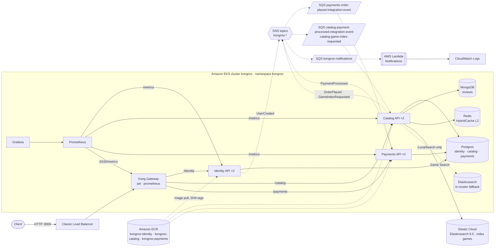

- Solid arrows are synchronous HTTP / driver calls; dashed arrows are asynchronous integration events
  and image pulls.
- **Elastic Cloud is the default search engine.** `eks/up.ps1 -LocalSearch` / `eks/apply.ps1 -LocalSearch`
  is the degraded mode for a lapsed Elastic Cloud trial: the base's single-node Elasticsearch stays in the
  cluster and Catalog searches it instead. Cloud day 1 ran in that mode; the same Catalog code serves both,
  only `Search:Uri` / `Search:Username` / `Search:Password` change.
- With `Messaging__Transport=RabbitMq` (compose, tests) the SNS/SQS pair is RabbitMQ exchanges/queues
  with identical semantics; MassTransit's EF Core outbox guarantees publish-after-commit either way.
- SNS topic names are fixed by contract (`MessagingTopics` in each service; `template.yaml` in
  Notifications): `kongroo-user-created`, `kongroo-user-role-changed`, `kongroo-order-placed`,
  `kongroo-payment-processed`, plus the Catalog-internal `kongroo-game-index-requested`. On Amazon SNS,
  `kongroo-user-role-changed` is created lazily (it only appears once a role change is actually
  published), so its absence on a fresh stack is expected, not a failure.
- Compose and local k3s run the same components on one machine, Kong on `localhost:8000` (k8s:
  LoadBalancer port 8000 on Rancher Desktop, whose Traefik owns port 80), with one API replica each and
  Elasticsearch in the stack. Run one mode at a time.

## Deployment

One AWS Academy Learner Lab account in `us-east-1`, three CloudFormation stacks, and one Elastic Cloud
deployment outside AWS's account boundary.

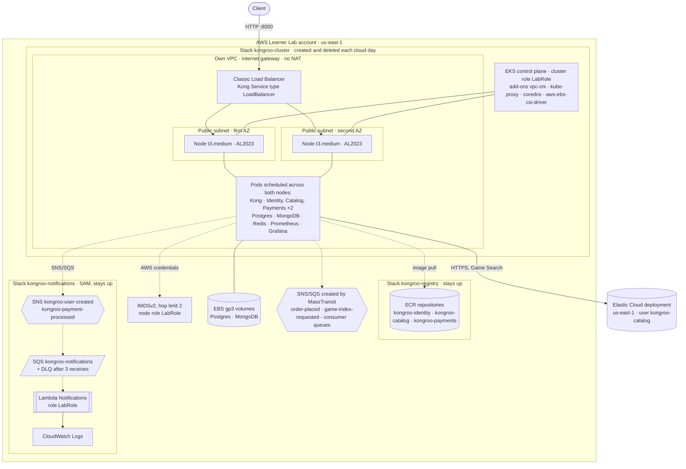

- **Cluster stack** (`eks/cluster-stack.yaml`, one per cloud day): its own VPC with two public subnets in
  two availability zones (`us-east-1a` and `us-east-1b` on cloud day 1), an internet gateway, public IPs on
  launch, no NAT gateway. A managed node group of **2 × t3.medium** (AL2023; min 0, desired 2, max 3).
  `eks/down.ps1` deletes it at the end of the day, after the `kongroo` namespace (and with it the load
  balancer and the volumes), so nothing is left billing.
- **Kong's Service** is the base's `type: LoadBalancer`; on EKS the in-tree controller turns it into a
  **Classic Load Balancer** on port 8000, the single public entry point. Grafana and Prometheus stay
  ClusterIP (`kubectl port-forward`). The load balancer's hostname changes every cloud day and is never
  committed; `eks/up.ps1` writes it to the git-ignored `eks/.env`.
- **AWS credentials:** no AWS key lives in the cluster. The pods (MassTransit's SNS/SQS client) use the
  node's `LabRole` through the instance metadata service: the launch template sets IMDSv2 with a hop
  limit of 2 so a pod's request reaches it. The Learner Lab offers neither IRSA nor Pod Identity (workspace
  ADR 0001).
- **The overlay** (`eks/kustomization.yaml`) is the local k3s base plus: ECR images at each repo's
  `master` SHA (filled at render time by `eks/apply.ps1`), **2 replicas** of each API, a default `gp3`
  StorageClass (the EBS CSI driver), Grafana's Service as ClusterIP, and RabbitMQ, the `aws-credentials` placeholder and (unless
  `-LocalSearch`) the local Elasticsearch removed. Postgres and MongoDB keep their data on EBS `gp3`
  volumes for the day. Elastic Cloud's URI and credentials reach Catalog only through `catalog-secret`,
  created from the hand-filled, git-ignored `eks/cloud.env`.
- **Registry stack** (`eks/registry-stack.yaml`) and the **Notifications SAM stack** stay up between cloud
  days, so images and the Lambda survive each teardown.
- **Bring-up order:** the `kongroo-notifications` stack must exist before any API starts. Its SAM template
  creates the topics `kongroo-user-created` and `kongroo-payment-processed`, and CloudFormation refuses topics
  MassTransit already created, so on a lab account without that stack `eks/up.ps1` deploys it through
  Notifications' pipeline (deleting stray copies of those two topics) before it applies the overlay.

## CI/CD

Each service repo carries one self-contained workflow, `.github/workflows/ci-cd.yml`, triggered by pull
requests to `master`, pushes to `master` and `workflow_dispatch`. Production is each repo's `master` HEAD
(workspace ADR 0002).

```mermaid
flowchart LR
    pr([Pull request to master]) --> build
    push([Push to master<br/>or workflow_dispatch]) --> build

    subgraph build[Job build]
        direction TB
        restore[Locked restore] --> fmt[CSharpier check] --> compile[Build<br/>warnings as errors]
        compile --> tests[Unit · integration · specs tests<br/>Testcontainers]
        tests --> secrets[Trivy secret scan<br/>of the repository]
        secrets --> image[docker build<br/>tag = full commit SHA]
        image --> trivy[Trivy image scan<br/>fails on fixable CRITICAL]
    end

    trivy -->|master only| hub[(Docker Hub<br/>josealmeidajr/kongroo-service:sha)]
    hub -->|ECR_REGISTRY set| ecr[(Amazon ECR<br/>kongroo-service:sha)]

    subgraph deploy[Job deploy · one at a time per repo]
        direction TB
        sts[sts get-caller-identity<br/>red: Lab credentials expired] --> kubeconfig[aws eks update-kubeconfig]
        kubeconfig --> setimage[kubectl set image] --> rollout[kubectl rollout status]
    end

    ecr --> sts
    rollout --> pods[EKS rolling update<br/>maxUnavailable 0 · maxSurge 1 · preStop 5 s]
```

- **APIs** (Identity, Catalog, Payments) follow the diagram. The Docker Hub push runs on `master` only; the
  ECR push and the `deploy` job run only while the repo is **armed** (variable `ECR_REGISTRY` and the lab's
  session keys as secrets, set by `eks/arm.ps1`, removed by `eks/down.ps1`), so between cloud days `master`
  stays green and stops at Docker Hub. The `deploy` job never touches Secrets.
- **Notifications** runs locked restore → CSharpier check → build → unit tests → Trivy secret scan →
  `sam build`; on `master`, when `SAM_DEPLOY=true`, the same `sts` preflight and `sam deploy` of stack
  `kongroo-notifications`.
- **Zero downtime:** readiness on `/health/ready`, `RollingUpdate` with `maxUnavailable: 0` / `maxSurge: 1`,
  a 5 s `preStop` sleep and 2 replicas on EKS. Manifest-only changes skip the pipeline: `eks/apply.ps1`.
- **Cloud day 1:** a one-line Catalog change pushed to `master` built in about 3–4 min, rolled out in about
  45 s, and served its first new response about 4 min after the push; the revert went the same way.
  `scripts/watch-release.ps1` saw 0 failed requests through both rollouts, and the deployed image SHA equalled
  `master` HEAD each time.

## Services

### Identity

User registration, authentication (JWT issuance), and authorization. Publishes user lifecycle events; consumes nothing.

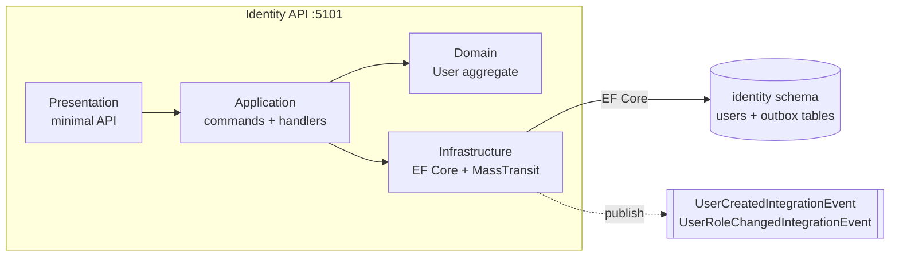

| Entity | Fields |
| --- | --- |
| User | Username, Email, PasswordHash, SecurityStamp, Name (PersonName), Role (User/Admin) |

| Endpoint | Description |
| --- | --- |
| `POST /users` | Register a user |
| `GET /users` | List all users (Admin) |
| `GET /users/me` | Current user's profile |
| `GET /users/{userId}` | Get user by id (Admin) |
| `PUT /users/{userId}/role` | Update a user's role (Admin) |
| `POST /tokens` | Login / issue JWT access token |

**Publishes:** `UserCreatedIntegrationEvent(UserId, Email, Name)`, `UserRoleChangedIntegrationEvent(UserId, PreviousRole, CurrentRole)`
**Consumes:** _(none)_
**Tables:** `identity.users` + MassTransit outbox (`outbox_state`, `outbox_message`, `inbox_state`)

### Catalog

Games, promotions, orders and the customer's library; reviews in MongoDB; cached reads in Redis; Game Search
in Elasticsearch. Publishes orders; consumes payment results and grants ownership on approval; publishes and
consumes its own `GameIndexRequested` to keep Game Search in step.

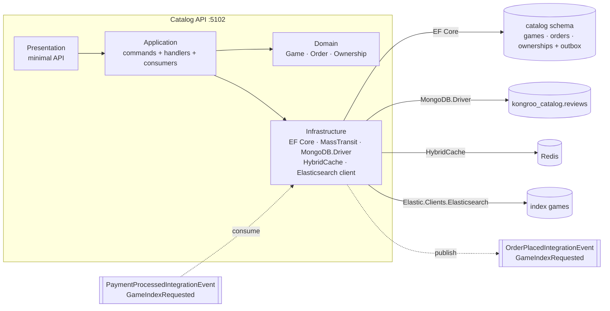

| Entity | Fields |
| --- | --- |
| Game | Title, Description, List Price (Money), Game Status (Draft/Published/Inactive) |
| Promotion | Discount (Percentage), Active Range (DateTimeRange) |
| Order | CustomerId, PurchasedAt, Total (Money), Status (Pending/Paid/Rejected), Lines[] |
| OrderLine | GameId, GameTitle, ListPrice, FinalPrice, AppliedPromotionId |
| Ownership | CustomerId, GameId, OrderId, AcquiredAt |
| Review (MongoDB) | GameId, CustomerId, CustomerName, Rating 1–5, Text?, CreatedAt — unique (GameId, CustomerId) |
| Game Search document (Elasticsearch) | id, title, description, status, priceAmount (List Price amount), currency |

| Endpoint | Description |
| --- | --- |
| `POST /games` | Create game (Admin) |
| `GET /games` | List games |
| `GET /games/{gameId}` | Get game |
| `PUT /games/{gameId}` | Update game (Admin) |
| `DELETE /games/{gameId}` | Delete game (Admin) |
| `POST /games/{gameId}/promotions` | Create promotion (Admin) |
| `GET /search?q=…&limit=…` | Game Search: Published games only, typo-tolerant, best match first |
| `GET /orders` | List own orders |
| `GET /orders/{orderId}` | Get order |
| `POST /orders` | Place order (purchase) |
| `GET /ownerships` | List library records |
| `GET /ownerships/{ownershipId}` | Get library record |
| `POST /games/{gameId}/reviews` | Submit a review (one per customer per game) |
| `GET /games/{gameId}/reviews` | Average rating, count, latest reviews |

**Publishes:** `OrderPlacedIntegrationEvent(OrderId, CustomerId, CustomerEmail, CustomerName, TotalAmount, Currency, Lines[{GameId, UnitPrice}])`; Catalog-internal `GameIndexRequested(GameId)`
**Consumes:** `PaymentProcessedIntegrationEvent(PaymentId, OrderId, CustomerId, CustomerEmail, CustomerName, TotalAmount, Currency, IsApproved, ProcessedAt)` — grants `Ownership` when `IsApproved` is true; `GameIndexRequested` — see [Game Search sync](#game-search-sync)
**Tables:** `catalog.games`, `catalog.promotions`, `catalog.orders`, `catalog.order_lines`, `catalog.ownerships` + MassTransit outbox
**MongoDB:** `kongroo_catalog.reviews` (via `MongoDB.Driver`)
**Cache:** see [Cache layers](#cache-layers)
**Search:** index `games`; see [Game Search sync](#game-search-sync)

### Payments

Simulates payment processing for a placed order using a configurable approval threshold.

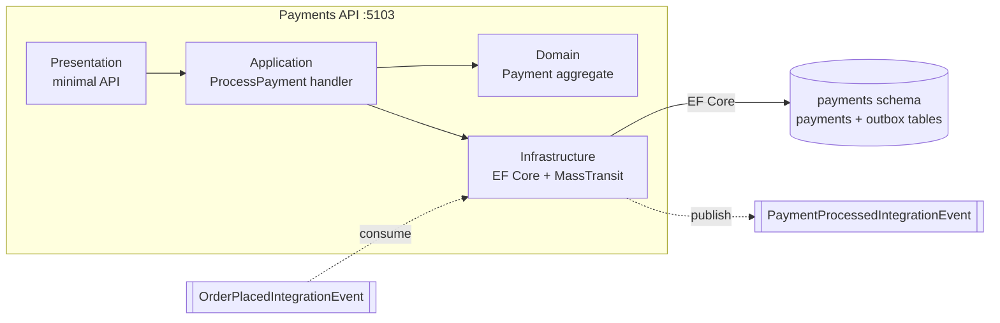

| Entity | Fields |
| --- | --- |
| Payment | OrderId, CustomerId, Email, CustomerName, Total (Money), Status (Pending/Approved/Rejected), ProcessedAt |

| Endpoint | Description |
| --- | --- |
| `GET /` | List caller's payments (Admin can pass `?customerId=`) |
| `GET /{orderId}` | Get payment by order id |

**Publishes:** `PaymentProcessedIntegrationEvent(PaymentId, OrderId, CustomerId, CustomerEmail, CustomerName, TotalAmount, Currency, IsApproved, ProcessedAt)`
**Consumes:** `OrderPlacedIntegrationEvent` — applies `ThresholdApprovalPolicy`: `IsApproved = TotalAmount <= Payments:ApprovalLimit` (default `1000.00`)
**Tables:** `payments.payments` + MassTransit outbox

> Approval is a pure threshold check on `TotalAmount` — no randomness.

### Notifications (AWS Lambda)

Serverless replacement for the Phase 2 container. Triggered by SQS, deployed with SAM by its own pipeline
to the AWS Academy Learner Lab account (`LabRole`), logs to CloudWatch.

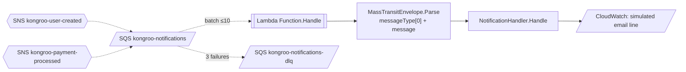

| Transient record | Fields |
| --- | --- |
| WelcomeEmail | To, Name |
| PurchaseConfirmationEmail | To, Name, OrderId, Amount, Currency |

**Consumes:** `UserCreatedIntegrationEvent` (welcome), `PaymentProcessedIntegrationEvent` (confirmation when `IsApproved`, skip line otherwise). Unknown types are acknowledged.
**Error handling:** malformed records are reported as partial batch failures and retried alone; after 3 receives they land in the DLQ.
**IaC:** `template.yaml` (topics, queue, DLQ, raw-delivery subscriptions, queue policy, function, log group), stack `kongroo-notifications`, deployed by Notifications' pipeline (`sam deploy`), and by `eks/up.ps1` through that pipeline on a lab account without it.

## Game Search sync

Game Search reads only Elasticsearch; Postgres stays the source of truth. Every game write asks for the
game's document to be brought in line, through Catalog's own EF Core bus outbox (Catalog ADR 0002), so the
write and the request commit together and a search outage never blocks catalog management.

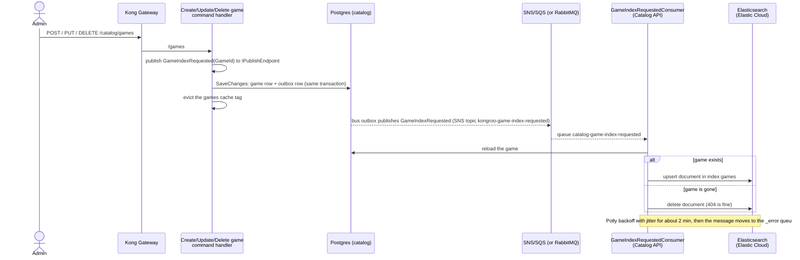

- **The message carries only the game id**; the consumer reloads the game on every attempt, so duplicates and
  reordering cannot write an older snapshot over a newer one.
- **Index lifecycle:** `GameSearchIndexInitializer`, a background service, creates index `games` with an
  explicit mapping when it is missing and, on the replica that created it, bulk-indexes every game from
  Postgres. It retries indefinitely while Elasticsearch is down without crashing the pod. Rebuild = delete
  the index and restart Catalog; `eks/up.ps1` deletes the Elastic Cloud index each cloud day for that reason.
- **Query** (`GET /search`, any authenticated user): `multi_match` over `title^3` and `description` with
  `fuzziness: AUTO`, filtered to **Published**, sorted by score; hits come from the index alone (id, title,
  description, List Price amount, currency, score). Not cached. Elasticsearch down → 503, and its health check
  is on `/health` but not `/health/ready`, so a search outage never takes Catalog pods out of service.

## Cache layers

Catalog reads go through `HybridCache`: an in-process L1 per pod in front of Redis (L2), with the database
behind both.

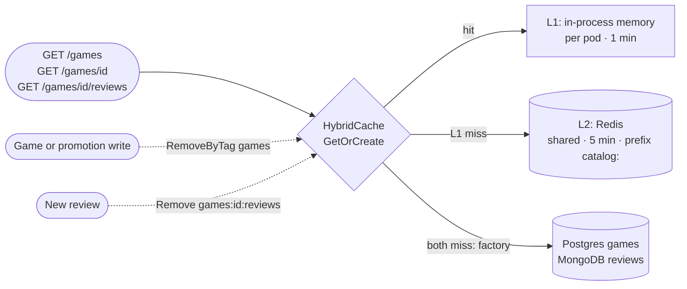

| Mode | `HybridCache__DefaultEntryOptions__Flags` on `deployment/catalog-api` | Path of a read |
| --- | --- | --- |
| L1 + Redis (default) | unset | L1 → Redis → database |
| Redis only | `DisableLocalCache` | Redis → database |
| off | `DisableLocalCache, DisableDistributedCache` | database every time |

- Every cached entry carries the `games` tag; game and promotion writes evict the tag, a new review removes its
  game's reviews key, and a 404 is never cached. TTLs come from the `HybridCache` configuration section
  (`Expiration` 5 min, `LocalCacheExpiration` 1 min).
- In Redis the keys are `catalog:games:<id>` and siblings, plus HybridCache's tag key `catalog:__MSFT_HCT__games`
  (`redis-cli --scan`).
- The effect is read on Grafana's **Catalog latency (p50 / p95) by route** panel (server side), driven by
  `load/catalog-cache.js` (k6); the steps and the measured numbers are in the README's
  [Cache demo](./README.md#cache-demo).

## Gateway

Kong Gateway 3.9 OSS, DB-less, one declarative file (`Kongroo.Orchestration/k8s/kong/kong.yaml`).
Routes strip the prefix and proxy to the ClusterIP Services on port 8080. The `jwt` plugin holds one
consumer (`identity`) whose credential key is the issuer `Kongroo.Identity.Api` and whose secret is the
shared HS256 signing key. Kong 3.9 OSS does not dereference vault references in that field, so the
committed file holds the placeholder `__JWT_SIGNING_KEY__` and Kong's start command substitutes
`JWT_SIGNING_KEY` (from `.env` or `kong-secret`) into a temporary copy. Register and login are the
only anonymous routes; all others, `/catalog/search` included, return Kong's 401 before reaching a
service. The `prometheus` plugin exposes edge metrics on the status port 8100. The same file serves
compose, local k3s and EKS.

## Observability

Identity, Catalog and Payments register OpenTelemetry metrics (ASP.NET Core, HttpClient, runtime,
MassTransit meter) and expose them with the Prometheus exporter at `/metrics`. Prometheus scrapes four
static targets (three APIs, Kong). Grafana provisions the **Kongroo** dashboard from
`k8s/grafana/dashboards/kongroo.json`, including the Catalog latency-by-route panel for the cache demo.
Lambda logs live in CloudWatch.

## Event Flows

### User Registration Flow

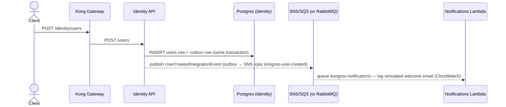

### Game Purchase Flow

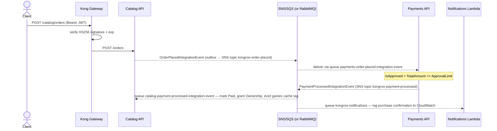

Verified end to end on EKS on cloud day 1 by `eks/smoke.ps1` through the Classic Load Balancer: Kong
answers 401 to an anonymous call, a missing token and a tampered token; register → login → create and publish a game → order settles `Paid` → review in MongoDB →
cached read; the Lambda logged the purchase confirmation for that order in CloudWatch; and a one-typo Game
Search found the game. The three APIs ran at 2 replicas each from ECR SHA tags.
